# Scenario 1 — Product Detail Presentation Patterns UX Contract

**Author:** Vuowng  
**Date:** 2026-11-07  
**Checkout/worktree:** `E:\demo-layout`  
**Branch/revision:** `feat/playground-compare` / `f357bcb82872768a1e3d02bebd96208b94ddd720`

## 1. Scope

This is a source-grounded planning contract for four complementary interaction patterns within Compare Scenario 1. It does not rank Drawer, Full Page, and Modal as competing universal choices. It defines when each pattern serves a different user task:

1. Product Label — read-only Drawer Quick View.
2. Promotion Type — compact Drawer Quick Edit for a simple highlight/classification case.
3. Promotion Offer — Full Page multi-section configuration.
4. Promotion History — read-only event Log Viewer Modal with prototype-only comments.

No application source, route, storage, theme, form, profile, or production contract was changed. This document describes prototype recommendations, not newly approved production standards.

## 2. Evidence and assumptions

### Verified current checkout evidence

- Current Scenario 1 is `drawer-vs-full-page`, titled “Drawer vs full-page edit”. Its task currently edits fictional `offer-1` and compares the Offer Type drawer with a full-page edit. Its seven criterion IDs are `completion`, `context`, `keyboard`, `narrow`, `confidence`, `validation`, and `deep-link`. The other four scenario IDs are `unsaved-changes`, `reorder-pagination`, `tabs-vs-anchor`, and `contextual-save` (`src/compare/scenarios.ts`).
- The current Scenario 1 Claude link is `/claude/offer-types/offer-1`; its legacy link is `/offer-types/offer-1`. Its proposed ChatGPT business destination is marked unavailable. It must not be presented as a working ChatGPT business screen (`src/compare/scenarios.ts`).
- Compare local records use the existing `compare-workspace:v1:` prefix and are keyed by scenario ID. Each record contains status, owner/date/rationale/open questions and notes keyed by criterion ID (`src/compare/records.ts`). The status identifier set includes `approved`; current UI and report semantics qualify it as a browser-local draft, not formal approval.
- Compare export has 22 fixed headers. It serializes fixed English scenario/criterion source text, CSV-escapes values, emits a BOM and CRLF, and downloads as `compare-matrix-local-draft.csv` (`src/compare/records.ts`).
- Claude currently has Promotion Type list/create/detail drawer routes and Promotion Offer list/create/edit routes. The Promotion Type drawer has Name, Code, and Status controls, uses Ant Design Form/FormInstance, and closes to its list. Its current form marks those three fields required (`src/claude/routes/route-meta.ts`, `src/claude/routes/route-config.tsx`, `src/features/promotion-types/PromotionTypeDrawerRoute.tsx`, `PromotionTypeForm.tsx`). This is current prototype behavior, not evidence of production API/route support.
- Promotion Offer currently has a full-page edit route. The current demo form includes name, code, offer type, status, start/end dates, and assigned products; the edit page has a contextual save bar and a dirty-state back-button restriction. This source does not establish the full route-exit guard behavior proposed below (`src/claude/routes/route-config.tsx`, `src/features/promotions/PromotionEditPage.tsx`, `PromotionForm.tsx`).
- Current Claude route metadata has no Product Label or Promotion History route. A search of current source and local reports found no Product Label implementation, event-history modal, or comment API. Current ChatGPT business screens for these pilots are also absent.
- The current language owner is i18next with Vietnamese and English resources. Compare UI uses translation keys, while CSV generation reads fixed English source values. Keep identifiers and persisted user text outside translation (`src/i18n`, `src/compare/CompareWorkspace.tsx`, `src/compare/records.ts`).
- The Design System index distinguishes **APPROVED DECISION**, **ADOPTED TARGET**, **CANDIDATE**, **LEGACY-COMPATIBILITY**, **NEEDS-TEAM-DECISION**, and **NOT VERIFIED**. Its adopted guidance prefers Ant Design where semantics fit, feature-owned behavior, visible keyboard focus, clear error feedback, readable responsive content, and preserving existing shell/form lifecycle contracts (`docs/design-system/README.md`, `patterns.md`, `components.md`, `layouts.md`, `status.md`).
- Repository-local `.codex/rules/` files referenced by the docs were not present in this checkout; `.codex/` contains agent definitions only. The repository `AGENTS.md` and installed skills were available and read.

### User-provided production audit context

The production audit was identified by the user as Jobs-to-home / `portal-cham-vay`, revision `733070b62ddf6ad25bc2b22a3488c41a0225c9a8`. Its supplied findings are treated as requirements context: Product Label is a suitable Quick View candidate; Promotion Type is the only conditional compact Drawer Quick Edit candidate; Promotion Offer needs Full Page; Promotion History supports event-level inspection; no production comment API was verified. The audit report/source was not found in this checkout, and the reference repository was not opened during this task. These findings are therefore **USER-PROVIDED CONTEXT**, not independently verified production evidence.

### Planning assumptions

- Fictional UI data only; no production data, API calls, permission claims, or production route support is implied.
- The existing Scenario 1 ID, five-scenario set, criterion IDs, local records and CSV contract stay stable. Existing observations are retained verbatim.
- For bilingual UI, labels and help text are displayed through existing i18next resources (`vi` default/fallback, `en` second language). The English CSV source remains locale-independent.
- Route examples below are proposed destinations only when explicitly marked proposed. They are not current routes.

## 3. Shared presentation-pattern decision framework

Choose a pattern from the task contract, not from record count alone. The dimensions below guide review; there is no approved numeric field threshold or universal pattern rule.

| Dimension | Drawer is favored when… | Full Page is favored when… | Modal is favored when… |
| --- | --- | --- | --- |
| Field/task complexity | A concise summary or small, fixed form can be understood without section navigation. | The workflow has many groups, conditional controls, section-level progress or substantial explanation. | The task is bounded to inspecting one event or confirming one focused action. |
| Dependencies | Fields are independent or have a small, local dependency. | Choices drive multiple later fields, sections, or validation rules. | Event fields are read-only; comment entry remains a small secondary action. |
| Business impact | Read-only review or a low-risk, reversible edit with clear confirmation. | High-impact or multi-step configuration needs review before commit. | No business record mutation; comment writes are clearly mock-only. |
| Need for list context | Preserving the originating list, filter, page, scroll and selection materially helps. | The operator needs uninterrupted space and can leave list context safely. | The operator is inspecting a single log item and should return to the same history list/detail. |
| History/log behavior | A short supporting summary can be shown in context. | A long timeline or multi-record investigation needs a dedicated workspace. | One event’s immutable detail and short thread fit in a focused viewer. |
| Accessibility | Overlay can manage focus, keyboard dismissal and return focus without trapping the task. | The task needs stable landmarks, section navigation and reliable error recovery. | Dialog focus containment is useful for a discrete review, with a clear close and focus return. |
| Permissions | Required permissions are known and can be checked before enabling edit. | Permission-dependent sections/actions need explanation or access recovery. | Read permission is known; mock comment permissions must not be represented as production authorization. |
| Routing | A route-backed overlay can preserve the list destination and direct-load behavior. | The edit has a canonical full route and reliable refresh/back behavior. | Event identity can be deep-linked or a direct URL can render an equivalent event page; otherwise keep the modal in-context and do not promise deep links. |

**Decision output:** document the user task, risk, data needs, exit behavior and route contract. If any dependency, permission, persistence, or route assumption is unverified, mark it **NEEDS-TEAM-DECISION** or **NOT VERIFIED** rather than treating a visual pattern as evidence.

## 4. Pilot contracts

### 4.1 Product Label — Drawer Quick View

**Pattern status:** Candidate prototype recommendation, consistent with the user-provided audit finding. No current Product Label route or feature is present in this repository.

| Contract area | Requirement |
| --- | --- |
| User goal and entry | From a Product Labels list, inspect one label without losing search, filters, sort, pagination, scroll position or selected row. Open using a clearly named row action or keyboard-activatable row control. |
| Data | Required for the fictional view: stable label ID and display name. Optional only when the chosen fixture actually supplies it: code, status, classification, associated product/category, effective dates, and updated timestamp. Do not add or infer production fields from this list. |
| Editable/read-only | Entire Quick View is read-only. Show each value with a text label; do not render disabled-looking edit controls. |
| Actions | Primary action: “Open full details” or “Edit label” only when a verified prototype destination exists. Secondary: Close. If no detail/edit route exists, do not render a dead link; show the capability as unavailable or omit it. |
| Validation/dependencies | No form validation. Missing optional fixture values render an explicit “Not provided” presentation; unknown/malformed record ID renders a not-found state. No inferred business dependency. |
| States | Loading: labeled skeleton. Empty: not applicable to a valid label; list empty state remains owned by the list. Error: inline retry and close. Success: read-only summary. Not found: clear message and return-to-list action. |
| Save/cancel/dirty | No save, cancel, dirty state, or unsaved prompt. Closing must not change the record. |
| Navigation/deep link | Close returns to the exact originating list URL/state. **Proposed only:** route-backed drawer state may encode the selected label in a list query or child route; a direct load must provide a usable list return. Current path is not established and must be owned by the future platform route registry. |
| Accessibility/focus | Trigger has an accessible name such as “View details for [label]”. On open, move focus to the drawer heading or first meaningful control; keep Tab within the drawer; Escape and visible close both close it; restore focus to the trigger. Provide a heading and definition-list/table semantics. Never convey status by color alone. |
| Responsive | Desktop drawer retains list context. At narrow width, use a full-width drawer/sheet or equivalent readable presentation; no horizontal clipping. Long values wrap, with copy action only if specifically approved. |
| vi/en | Translate title, field labels, loading/error/empty copy and actions through existing namespaces. Keep label IDs, code values and fictional record data stable. Allow translated labels to wrap. |
| Data boundary | Fictional fixtures only. No production Product Label API or current route support is evidenced. |
| Acceptance | Open from a filtered/paginated list; inspect without editing; close and find the same list state/row; keyboard open/close returns focus; missing record produces recoverable not-found; direct-link behavior is tested before it is advertised. |

### 4.2 Promotion Type — Drawer Quick Edit

**Pattern status:** Conditional prototype recommendation. The user clarified the “mechanism” is a simple highlight/classification only. Do not infer a production route, validation contract, permissions, or API from the local prototype.

| Contract area | Requirement |
| --- | --- |
| User goal and entry | Create or edit a Promotion Type from its list and return to the same list context. The drawer is appropriate only while the model remains compact, the task is fixed, and the highlight/classification control stays simple. If it gains dependencies, complex rules or review steps, reassess it as Full Page. |
| Data | Current local fixture supports `id`, `name`, `code`, and `status`; its form currently requires Name, Code, and Status. Proposed 5-field prototype shape: those three current fields plus optional short display label and optional simple highlight/classification choice. The two added fields and the classification options are **CANDIDATE**, not current data or approved production requirements. Do not add a “mechanism” rules engine. |
| Editable/read-only | Create: editable fields above; ID is generated/read-only. Edit: same supported fields editable; immutable ID and any derived audit metadata read-only. Do not expose fields without a fictional fixture/model decision. |
| Actions | Primary: “Create Promotion Type” or “Save changes”. Secondary: Cancel/Close. No delete action is implied. Keep action labels specific to create vs edit. |
| Validation/dependencies | Preserve current demo-required Name, Code, Status validation. Show field-level messages and focus first invalid field on submit. Optional display label has a documented length only after a prototype decision. Classification is a simple selection, not conditional business logic. Duplicate-code behavior is not established; mock only if a deterministic rule is separately specified. |
| States | Initial/loading: skeleton for existing detail. Empty/new: blank form with defaults limited to current fixture behavior. Load error/not-found: inline explanation and retry/back. Save pending: disable duplicate submission and expose progress. Save error: keep drawer and values, show actionable error. Success: close drawer, update list row, announce success. |
| Save/cancel/dirty | Clean close returns immediately. Dirty close through Cancel, X, mask, Escape, route navigation or Back must use one consistent discard confirmation. “Stay editing” retains values/focus; “Discard changes” returns to list. Save validates first; no close on failure. |
| Navigation/deep link | Current Claude prototype already has list-child create/detail drawers at `/claude/promotion-types/create` and `/claude/promotion-types/:id`; close returns to `/claude/promotion-types`. Keep that current topology. Do not claim production supports these URLs. Direct loads must have a usable close destination and handle invalid IDs. |
| Accessibility/focus | Give drawer a programmatic heading; associate persistent top-aligned labels and errors; set initial focus to heading or first field; contain keyboard focus; close on Escape unless dirty confirmation is required; restore focus to the row action. Pending and error states are announced. |
| Responsive | Use full viewport width on narrow screens; keep footer actions visible without obscuring the last field; one-column controls; no fixed width that truncates Vietnamese labels. |
| vi/en | Localize all field labels, required/optional notes, validation, confirmation and status presentation. Keep `id`, field names, enum/status values and submitted data unchanged. |
| Data boundary | Only the current local fictional fixture/service is evidenced. No production API or production edit permission is established. |
| Acceptance | Valid create/edit saves once in the mock, updates list, and closes; invalid input retains values and focuses first error; every dirty exit prompts consistently; optional highlight/classification has no hidden conditional behavior; direct drawer URL remains usable and closes to the correct list. |

### 4.3 Promotion Offer — Full Page

**Pattern status:** Full Page is the user-provided production audit recommendation for the multi-section task. The current prototype has a full-page edit route, but its current form fields and dirty-state behavior do not prove the proposed production workflow.

| Contract area | Requirement |
| --- | --- |
| User goal and entry | Create or edit an offer with multiple groups, conditional fields and validation. Enter from Promotions list or a canonical direct URL. Full Page provides room for section navigation, review and recovery without compressing the workflow into an overlay. |
| Data | Current demo-required fields: name, code, offer type, status, start date, end date, assigned products. Additional conditional values are fictional-only proposals and must be described before use. Mark optional fields explicitly; do not infer real offer rules, calculations or API payloads. |
| Editable/read-only | Editable configuration fields according to the selected fictional offer. Record ID and system-owned audit information are read-only. Conditional fields appear only when their controlling choice requires them and preserve their values predictably when toggled or explain when a value is cleared. |
| Actions | Primary: “Save changes” / “Create offer”. Secondary: “Cancel” or return to list. If a draft action is added, distinguish it from active/publish semantics; no publish action is implied by the existing source. Keep one clear primary action. |
| Validation/dependencies | Keep Ant Design Form/FormInstance as state/validation owner. Validate locally on submit and on relevant blur/change without erasing other unresolved errors. A page-level summary links to each invalid section/field, then focus moves to the first error. Conditional rules and date relationships must be fictional and explicitly stated. Current source requires the seven fields listed above; no production validation contract is inferred. |
| States | Loading: page skeleton with stable heading. Initial/create: empty form. Load error/not-found: recoverable page error. Validation error: summary plus field messages and section navigation. Saving: pending label/disabled duplicate action. Save failure: preserve entered values and show recovery. Success: confirmation and explicit next step (stay on saved detail or return to list). |
| Save/cancel/dirty | Dirty state is visible at all times. Save validates, saves once and keeps the user on the page unless an explicit post-save destination is chosen. Cancel/route links prompt before discarding. Browser Back and platform navigation must also be guarded where the router permits. `beforeunload` warning should be used only for actual unsaved changes and cannot be styled/customized by the app. Existing `PromotionEditPage` has a contextual save bar and disables its back button while dirty; complete route-exit behavior is **NOT VERIFIED**. |
| Navigation/deep link | Current prototype edit route is `/claude/promotions/:id/edit`; create is `/claude/promotions/create`. Preserve route ownership, lazy loading, basename and legacy behavior. Direct load/refresh should render the same fictional record and a clear return path. New section navigation should use in-page anchors or tabs only after choosing error/focus behavior; it must not create fake production routes. |
| Accessibility/focus | Use one page-level `h1`, semantic section headings/landmarks, persistent labels, inline errors plus summary, keyboard-reachable section links, visible focus, and focus to the first error. Announce saving/success/error. Ensure conditional appearance does not move focus unexpectedly. |
| Responsive | Desktop may use a main form column plus section navigation; at 768 px and below collapse to a single column; at 320 px keep fields/actions readable, avoid horizontal scrolling, and keep save/discard reachable without covering controls. Review long Vietnamese text at all breakpoints. |
| vi/en | Translate page/section titles, field labels/help, validation, status display and feedback. Persisted enum/date values and submission values remain stable; use locale-aware display only. CSV remains English. |
| Data boundary | Use fictional data and local mock behavior. Current query hooks/services are repository prototype behavior and do not prove production API availability or authorization. |
| Acceptance | Direct load and refresh work; conditional fields display and validate only for their documented condition; summary navigation reaches and focuses invalid controls; save failure preserves values; every exit warns on dirty data; save success is announced; list context is recoverable. |

### 4.4 Promotion History — Log Viewer Modal

**Pattern status:** Prototype recommendation for inspecting one immutable event. Current source has no Promotion History page, event payload contract, copy policy, or comment API/permission model.

| Contract area | Requirement |
| --- | --- |
| User goal and entry | From a Promotion History list/timeline, inspect one event and its comments, then return to the same event row and list context. Open from a keyboard-accessible “View event details” control. |
| Event identity/audit fields | Mock record should include immutable `eventId`, parent promotion ID, event type, timestamp with timezone, actor display identity, action/source, and outcome. Include correlation/request ID only if useful in the fictional example. Show field-level before/after values for changed fields, with unchanged fields omitted or explicitly labeled. All IDs are synthetic. |
| Editable/read-only data | Event metadata and before/after snapshot are strictly read-only. Comments are separate child records. Never edit, replace, or delete the original event through this viewer. |
| Copy behavior | Provide “Copy event details” only for an explicitly approved, safe display allowlist. Copy a readable plain-text summary containing event identity/time/type and permitted changes; exclude hidden values, comments by default, and masked values. Show copy success. If clipboard access fails, keep text selectable and announce a manual-copy fallback. Which fields are approved to copy is **NEEDS-TEAM-DECISION**. |
| Comment thread | Render comments with body, mock author and timestamp; oldest/newest ordering must be consistent and stated. New comment composer has a persistent label, helper text (“Prototype only; saved in this browser”), non-empty/length validation, character count where useful, and Submit/Cancel. Editing/deleting comments is out of scope unless separately decided. |
| Comment submission/error | Pending: disable duplicate submit and announce progress. Success: append a new comment without altering the event, clear only the submitted draft, announce success. Validation error: retain draft and focus/announce the field error. Mock persistence failure: retain text and offer retry; do not show a false success. Empty thread: explanatory empty state. Event load error/not-found: modal error with retry/close. |
| Mock persistence | If persistence across refresh is needed, use a dedicated prototype-only localStorage namespace separate from `compare-workspace:v1:` and Claude decision keys; scope it to this browser profile, with no cross-device/team sync, backend, production API, or formal audit guarantee. If storage is unavailable, retain the comment in memory for the open session and disclose that it was not persisted. Never put real event/customer content in this store. |
| Save/close/dirty | Event data is never dirty. A typed unsent comment is dirty. Close/X/Escape/backdrop with an empty composer closes immediately; with a draft, offer Stay/Discard. On close, return focus to the event trigger and preserve the originating list position/filter. |
| Navigation/deep link | **Proposed, not current route:** a platform-owned promotion-history route with a stable event identifier (for example, `/claude/promotions/:promotionId/history/:eventId`) can render the modal over its history context for in-app navigation. Direct load must still show event details and a reliable way back, even if no list state exists. Route owner must choose whether direct load renders modal-over-page or a standalone detail fallback. Do not add this route without separate implementation authorization. |
| Accessibility/focus | Use a named dialog with `aria-modal`, title/description, focus containment, initial focus on heading or close control, Escape behavior, and return focus. Use a semantic definition list for audit fields and a table/list for before/after changes. Announce comments and status feedback. Do not rely on color or icon alone. Ensure copy and comment buttons have clear accessible names. |
| Responsive | Desktop modal has bounded height with one deliberate scroll region. On narrow screens use a full-screen dialog/sheet, stack before/after values, avoid nested horizontal scroll, and keep close and comment submit reachable. If the event plus thread becomes too large, promote the viewer to a dedicated full page rather than nesting scroll panes. |
| vi/en | Translate chrome, labels, comment controls, empty/error/success and copy feedback. Do not translate event IDs, raw audit values, user-authored comment text, or copied source values. Localize displayed timestamps while preserving the original ISO instant/timezone in the mock record. |
| Sensitive-value masking | Default to synthetic, already-masked values for account numbers, phone/email, tokens, credentials and financial identifiers. Never include raw secrets or production customer data. If a field’s sensitivity is unknown, mask it. No reveal action is included until an owner defines authorization and auditing. The exact field allowlist/mask rules are **NEEDS-TEAM-DECISION**. |
| Permissions/data boundary | UI uses a fixed “Demo operator” identity and makes no claim about real roles, authorization, approval, retention or audit integrity. No backend comments or permission model exists in evidence. |
| Acceptance | Opening the modal preserves history context; keyboard focus enters, stays, and returns; event metadata and before/after data are immutable; copy excludes masked/non-allowlisted data and has success/failure paths; comments append without changing the event; unsent comments survive validation/storage errors; storage is browser-local and isolated; direct-link behavior is tested before advertised. |

## 5. Interaction and state transitions

```mermaid
stateDiagram-v2
  [*] --> List
  List --> QuickView: Product Label row action
  QuickView --> List: Close / Escape / backdrop
  QuickView --> Detail: verified detail destination
  List --> QuickEdit: Promotion Type create/edit
  QuickEdit --> QuickEditInvalid: Save with errors
  QuickEditInvalid --> QuickEdit: Correct fields
  QuickEdit --> Saving: Valid Save
  Saving --> List: Success and row refresh
  Saving --> QuickEdit: Save error; retain values
  QuickEdit --> ConfirmDiscard: Dirty exit
  ConfirmDiscard --> QuickEdit: Stay editing
  ConfirmDiscard --> List: Discard
  List --> FullPage: Promotion Offer create/edit
  FullPage --> FullPageInvalid: Invalid submit
  FullPageInvalid --> FullPage: Navigate to error and correct
  FullPage --> Saving: Valid Save
  Saving --> FullPage: Success or error feedback
  FullPage --> ConfirmDiscard: Dirty route exit
  List --> EventModal: Promotion History event
  EventModal --> EventModal: Copy / comment
  EventModal --> ConfirmDiscard: Close with comment draft
  ConfirmDiscard --> EventModal: Keep draft
  ConfirmDiscard --> List: Discard and close
```

The diagram expresses the proposed interaction contract. It is not evidence that each state/route currently exists.

## 6. Shared acceptance criteria

- Each pattern is selected for the distinct task described above; there is no blanket “drawer versus page” winner.
- Every entry action is keyboard-operable and has a clear accessible name. Overlay open/close behavior manages focus and preserves the originating context.
- State feedback is distinguishable: loading, empty/not-found, validation, save pending, success and recoverable failure. Failed saves never clear user input.
- Save, Cancel, Close, Discard, Copy, and Comment actions state their effects. Dirty-state protection covers every supported exit route.
- Stable route IDs, platform-owned route metadata, React Router lazy boundaries and GitHub Pages basename remain owned by platform routing. Proposed destinations are unavailable until actually implemented.
- All displayed UI copy has Vietnamese and English resources. Vietnamese is the default/fallback; changing language does not alter the URL or clear form/Compare state. Labels can wrap at narrow widths.
- Internal scenario ID remains `drawer-vs-full-page`; the other four scenario IDs and all existing criterion IDs remain unchanged. No storage-key migration or clearing occurs.
- Existing Compare local records, notes, evidence and decision statuses are preserved. “Approved” remains a browser-local draft only.
- Compare CSV stays at 22 columns and keeps its English system-owned prose, fixed header order, row shape, escaping, BOM, CRLF and `compare-matrix-local-draft.csv` filename. Locale switching cannot change the export language. Any English description update for the new Scenario 1 scope must be intentional and must not change the schema or IDs.
- All data is fictional. No production API, real customer record, secret, comment permission, retention rule, or audit guarantee is implied.

## 7. Accessibility and bilingual requirements

The project’s **APPROVED TARGET** is WCAG 2.2 AA; that target is not a conformance claim. The DS **ADOPTED TARGET** calls for visible keyboard focus, readable content, contrast review, accessible names, clear errors, responsive behavior, and status meaning that does not rely on color alone. Use Ant Design 5 controls when their existing semantics fit; keep the component and business behavior feature-owned. Do not invent focus, hover, disabled, or other unresolved production tokens.

For both `vi` and `en`:

- Translate headings, persistent labels, helper text, required/optional cues, validation, actions, status labels and live feedback.
- Keep stable identifiers, form values, enum/status IDs, route parameters, event data and user-authored notes/comments unmodified.
- Let translated labels wrap; avoid fixed widths and truncation in drawer titles, modal headings, buttons, breadcrumbs, tables and error summaries.
- Use locale-aware display for timestamps while retaining machine values. Keep CSV descriptions English by contract.
- Verify keyboard-only operation, focus visibility/return, dialog focus containment, error announcement/focus, text/control contrast, and layouts at 320/768/1280 px. No rendered verification has been performed for this contract.

## 8. Risks and NEEDS-TEAM-DECISION

1. **Scenario 1 stored-note context — NEEDS-TEAM-DECISION.** Retitling `drawer-vs-full-page` changes the meaning attached to existing notes because current records have no scenario-version field. The user has directed that observations/evidence, scenario ID and current storage contract be preserved, with no migration. Keep every existing record and criterion ID; do not clear or silently remap notes. Before implementation, decide whether to show an always-visible “Scenario scope updated; review existing notes” notice or retain the previous scope text beside the new pilot contract. The current key cannot distinguish old/new records.
2. **Criterion coverage — NEEDS-TEAM-DECISION.** Existing seven criterion IDs must remain to avoid dropping notes in `loadRecord()`. Determine whether those general criteria are sufficient for all four pilots. Do not add/remove criterion IDs without an explicitly authorized storage migration and CSV impact review. Pilot-specific acceptance criteria in this document can be implementation checks without adding Compare worksheet rows.
3. **Product Label attributes/route — NEEDS-TEAM-DECISION.** The current repo has no Product Label route or source model. Choose the exact fictional fields, owner platform, canonical route and list return-state contract. User-provided production audit describes suitability, not current runtime support.
4. **Promotion Type field set — NEEDS-TEAM-DECISION.** Current source has three fields. Decide whether two optional prototype fields (short display label and simple highlight/classification) are included and what fictional values they use. Do not infer production schema, requiredness, mechanism behavior, permissions or API support.
5. **Promotion Offer dependencies — NEEDS-TEAM-DECISION.** Define only the fictional conditional fields and validation needed for the prototype. Production field rules and API contracts were not inspected or supplied in source.
6. **History data, copy, masking and permissions — NEEDS-TEAM-DECISION.** Define event field allowlist, copyable fields, sensitive-value classes, masking policy, mock author identity, comment length/edit/delete behavior and whether prototype comments persist beyond a session. No production comment API or permission model is established. Until decisions exist, use synthetic masked records, no reveal action, and no production-data integration.
7. **History route/deep link — NEEDS-TEAM-DECISION.** Confirm the parent platform/route and direct-load fallback before exposing event URLs. No history route exists in current metadata.
8. **Browser behavior — NOT VERIFIED.** Focus trap/return, dirty exits, clipboard fallback, narrow layout, Vietnamese text expansion and screen-reader announcements require browser/manual acceptance. WCAG conformance is not claimed.

## 9. Implementation sequencing

1. **Resolve data/context guardrails:** confirm existing-note retitle messaging, criterion sufficiency, Product Label mock fields/route, Promotion Type candidate fields, Promotion Offer fictional dependencies, and History copy/mask/comment boundaries.
2. **Define stable scenario presentation:** keep `drawer-vs-full-page`; retain all five scenario IDs and current criterion IDs; keep current localStorage records untouched. Put bilingual display title/task/step text in existing Compare translation resources. Keep English source descriptions for export independent from i18next; review any English Scenario 1 description change for export meaning without changing its 22-column schema.
3. **Implement one pilot at a time under platform ownership:** Product Label read-only Quick View; Promotion Type create/edit drawer using the existing list-child route where appropriate; Promotion Offer Full Page and complete dirty-route guard; Promotion History event modal with isolated fictional comment records. Do not create new routes before route ownership and direct-link behavior are agreed.
4. **Integrate the Compare worksheet without migration:** update only display copy and destination availability after destinations exist; preserve IDs, criterion keys, observations, evidence, status semantics, local-draft wording and CSV contract. Mark unavailable destinations clearly until implemented.
5. **Validate behavior:** focused unit/executable checks where supported; then browser checks for direct links, list context, overlay focus, validation recovery, dirty exits, clipboard, mock storage failure and cross-language state retention. Recheck CSV headers/ordering/BOM/CRLF/escaping/filename and localStorage keys. Record static, browser and deployed evidence separately.

This contract authorizes no implementation. Any later source work needs a separate implementation task and must preserve the constraints above.
